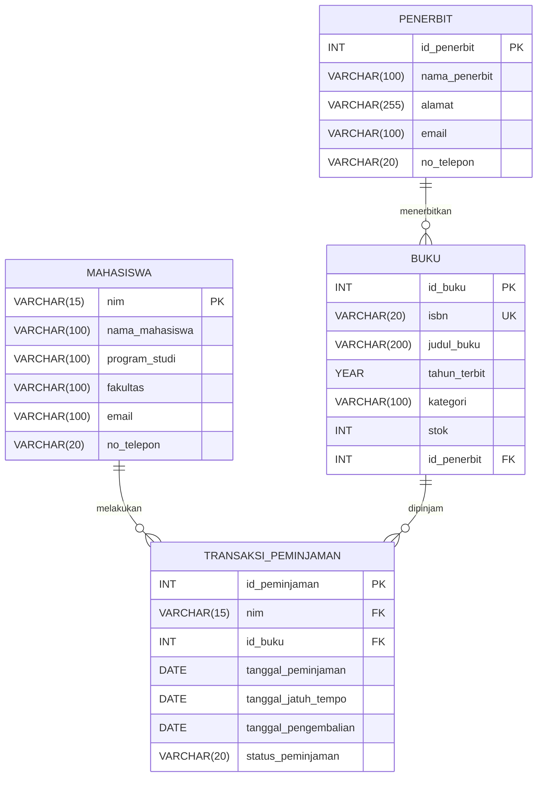

# Tugas Mandiri 6
## Perancangan ERD E-Library Kampus

## 1. Deskripsi Sistem

Sistem E-Library Kampus merupakan sistem basis data relasional yang digunakan
untuk mengelola data mahasiswa, buku, penerbit, serta transaksi peminjaman
dan pengembalian buku.

---

## 2. Perancangan Entitas

Sistem E-Library Kampus memiliki empat entitas utama, yaitu Mahasiswa, Buku,
Penerbit, dan Transaksi Peminjaman.

### 2.1 Entitas Mahasiswa

Entitas Mahasiswa menyimpan data identitas mahasiswa yang menggunakan layanan
perpustakaan.

| Atribut | Keterangan | Key |
|---|---|---|
| nim | Nomor Induk Mahasiswa | PK |
| nama_mahasiswa | Nama lengkap mahasiswa | - |
| program_studi | Program studi mahasiswa | - |
| fakultas | Fakultas mahasiswa | - |
| email | Alamat email mahasiswa | - |
| no_telepon | Nomor telepon mahasiswa | - |

**Primary Key:** `nim`

---

### 2.2 Entitas Buku

Entitas Buku menyimpan informasi mengenai koleksi buku yang tersedia di
perpustakaan.

| Atribut | Keterangan | Key |
|---|---|---|
| id_buku | Identitas unik buku | PK |
| isbn | Nomor ISBN buku | - |
| judul_buku | Judul buku | - |
| tahun_terbit | Tahun terbit buku | - |
| kategori | Kategori buku | - |
| stok | Jumlah stok buku | - |
| id_penerbit | Identitas penerbit buku | FK |

**Primary Key:** `id_buku`

**Foreign Key:** `id_penerbit` → `Penerbit.id_penerbit`

---

### 2.3 Entitas Penerbit

Entitas Penerbit menyimpan informasi mengenai penerbit yang menerbitkan
buku-buku dalam sistem.

| Atribut | Keterangan | Key |
|---|---|---|
| id_penerbit | Identitas unik penerbit | PK |
| nama_penerbit | Nama penerbit | - |
| alamat | Alamat penerbit | - |
| email | Alamat email penerbit | - |
| no_telepon | Nomor telepon penerbit | - |

**Primary Key:** `id_penerbit`

---

### 2.4 Entitas Transaksi Peminjaman

Entitas Transaksi Peminjaman menyimpan riwayat peminjaman dan pengembalian
buku yang dilakukan oleh mahasiswa.

| Atribut | Keterangan | Key |
|---|---|---|
| id_peminjaman | Identitas unik transaksi peminjaman | PK |
| nim | Mahasiswa yang melakukan peminjaman | FK |
| id_buku | Buku yang dipinjam | FK |
| tanggal_peminjaman | Tanggal buku dipinjam | - |
| tanggal_jatuh_tempo | Batas waktu pengembalian buku | - |
| tanggal_pengembalian | Tanggal buku dikembalikan | - |
| status_peminjaman | Status transaksi peminjaman | - |

**Primary Key:** `id_peminjaman`

**Foreign Key:**
- `nim` → `Mahasiswa.nim`
- `id_buku` → `Buku.id_buku`

---

### 2.5 Hubungan Antar Entitas

Hubungan antar entitas dalam sistem adalah sebagai berikut:

1. Satu **Penerbit** dapat menerbitkan banyak **Buku**.
2. Satu **Buku** diterbitkan oleh satu **Penerbit**.
3. Satu **Mahasiswa** dapat melakukan banyak **Transaksi Peminjaman**.
4. Satu **Transaksi Peminjaman** dilakukan oleh satu **Mahasiswa**.
5. Satu **Buku** dapat muncul dalam banyak **Transaksi Peminjaman**.
6. Satu **Transaksi Peminjaman** hanya berkaitan dengan satu **Buku**.

Dengan demikian, kardinalitas hubungan antar entitas adalah:

- `Penerbit 1 : N Buku`
- `Mahasiswa 1 : N Transaksi Peminjaman`
- `Buku 1 : N Transaksi Peminjaman`
---

## 3. Normalisasi

Normalisasi dilakukan untuk mengurangi redundansi data, mencegah anomali
insert, update, dan delete, serta menghasilkan struktur basis data yang
lebih terorganisasi.

### 3.1 Unnormalized Form (UNF)

Pada bentuk UNF, data masih berada dalam satu tabel besar dan dapat memiliki
kelompok data berulang.

Contoh tabel awal:

| NIM | Nama Mahasiswa | Program Studi | Buku | Penerbit | Tanggal Peminjaman | Tanggal Jatuh Tempo | Tanggal Pengembalian |
|---|---|---|---|---|---|---|---|
| D121241083 | Nadiah Alya Khirani | Teknik Informatika | Basis Data, Pemrograman Web | Andi, Informatika | 2026-09-01, 2026-09-03 | 2026-09-08, 2026-09-10 | 2026-09-07, - |
| D121241084 | Aisyah Putri | Sistem Informasi | Basis Data | Andi | 2026-09-02 | 2026-09-09 | 2026-09-08 |

Pada kondisi tersebut terdapat kelompok data berulang pada atribut Buku,
Penerbit, tanggal peminjaman, tanggal jatuh tempo, dan tanggal pengembalian.

Masalah pada UNF:

- Satu mahasiswa dapat memiliki lebih dari satu buku dalam satu baris.
- Beberapa atribut memiliki lebih dari satu nilai.
- Data sulit dicari dan diperbarui.
- Terdapat redundansi data mahasiswa dan penerbit.

---

### 3.2 First Normal Form (1NF)

Untuk mencapai 1NF, setiap atribut harus memiliki nilai atomik atau satu
nilai untuk setiap sel. Data yang berulang dipisahkan menjadi beberapa baris.

Contoh hasil 1NF:

| NIM | Nama Mahasiswa | Program Studi | ID Buku | Judul Buku | Penerbit | Tanggal Peminjaman | Tanggal Jatuh Tempo | Tanggal Pengembalian |
|---|---|---|---|---|---|---|---|---|
| D121241083 | Nadiah Alya Khirani | Teknik Informatika | B001 | Basis Data | Andi | 2026-09-01 | 2026-09-08 | 2026-09-07 |
| D121241083 | Nadiah Alya Khirani | Teknik Informatika | B002 | Pemrograman Web | Informatika | 2026-09-03 | 2026-09-10 | - |
| D121241084 | Aisyah Putri | Sistem Informasi | B001 | Basis Data | Andi | 2026-09-02 | 2026-09-09 | 2026-09-08 |

Setiap sel sekarang hanya memiliki satu nilai.

Namun, masih terdapat redundansi. Contohnya:

- Nama dan program studi mahasiswa D121241083 ditulis berulang.
- Judul dan penerbit buku B001 ditulis berulang.
- Informasi mahasiswa bergantung pada NIM.
- Informasi buku bergantung pada ID Buku.

---

### 3.3 Second Normal Form (2NF)

Untuk mencapai 2NF, tabel harus sudah memenuhi 1NF dan setiap atribut
non-key harus bergantung sepenuhnya pada primary key.

Pada tabel 1NF terdapat beberapa ketergantungan data:

- `NIM → Nama Mahasiswa, Program Studi`
- `ID Buku → Judul Buku, Penerbit`
- `(NIM, ID Buku, Tanggal Peminjaman) → Tanggal Jatuh Tempo, Tanggal Pengembalian`

Data mahasiswa dan data buku tidak bergantung pada keseluruhan data transaksi.
Oleh karena itu, data mahasiswa dan buku dipisahkan dari data transaksi.

#### Tabel Mahasiswa

| NIM | Nama Mahasiswa | Program Studi |
|---|---|---|
| D121241083 | Nadiah Alya Khirani | Teknik Informatika |
| D121241084 | Aisyah Putri | Sistem Informasi |

#### Tabel Buku

| ID Buku | Judul Buku | Penerbit |
|---|---|---|
| B001 | Basis Data | Andi |
| B002 | Pemrograman Web | Informatika |

#### Tabel Transaksi Peminjaman

| ID Peminjaman | NIM | ID Buku | Tanggal Peminjaman | Tanggal Jatuh Tempo | Tanggal Pengembalian |
|---|---|---|---|---|---|
| P001 | D121241083 | B001 | 2026-09-01 | 2026-09-08 | 2026-09-07 |
| P002 | D121241083 | B002 | 2026-09-03 | 2026-09-10 | - |
| P003 | D121241084 | B001 | 2026-09-02 | 2026-09-09 | 2026-09-08 |

Dengan pemisahan tersebut:

- Data mahasiswa hanya disimpan pada tabel Mahasiswa.
- Data buku hanya disimpan pada tabel Buku.
- Data transaksi hanya menyimpan referensi mahasiswa dan buku melalui
  Foreign Key.

---

### 3.4 Third Normal Form (3NF)

Untuk mencapai 3NF, tabel harus sudah memenuhi 2NF dan tidak boleh terdapat
ketergantungan transitif antara atribut non-key.

Pada tabel Buku sebelumnya terdapat ketergantungan:

`ID Buku → Penerbit`

Namun, informasi penerbit dapat memiliki beberapa atribut seperti nama,
alamat, email, dan nomor telepon.

Jika seluruh informasi tersebut disimpan pada tabel Buku, maka akan terjadi
pengulangan data penerbit untuk setiap buku yang diterbitkannya.

Oleh karena itu, informasi penerbit dipisahkan menjadi tabel Penerbit.

#### Tabel Mahasiswa

| NIM | Nama Mahasiswa | Program Studi | Fakultas | Email | No. Telepon |
|---|---|---|---|---|---|
| D121241083 | Nadiah Alya Khirani | Teknik Informatika | Teknik | nadiah@example.com | 081234567890 |
| D121241084 | Aisyah Putri | Sistem Informasi | Teknik | aisyah@example.com | 081234567891 |

#### Tabel Penerbit

| ID Penerbit | Nama Penerbit | Alamat | Email | No. Telepon |
|---|---|---|---|---|
| P001 | Andi | Yogyakarta | info@andi.co.id | 0274123456 |
| P002 | Informatika | Bandung | info@informatika.co.id | 0221234567 |

#### Tabel Buku

| ID Buku | ISBN | Judul Buku | Tahun Terbit | Kategori | Stok | ID Penerbit |
|---|---|---|---|---|---|---|
| B001 | 9781234567890 | Basis Data | 2025 | Database | 5 | P001 |
| B002 | 9780987654321 | Pemrograman Web | 2026 | Pemrograman | 3 | P002 |

#### Tabel Transaksi Peminjaman

| ID Peminjaman | NIM | ID Buku | Tanggal Peminjaman | Tanggal Jatuh Tempo | Tanggal Pengembalian | Status Peminjaman |
|---|---|---|---|---|---|---|
| P001 | D121241083 | B001 | 2026-09-01 | 2026-09-08 | 2026-09-07 | Dikembalikan |
| P002 | D121241083 | B002 | 2026-09-03 | 2026-09-10 | - | Dipinjam |
| P003 | D121241084 | B001 | 2026-09-02 | 2026-09-09 | 2026-09-08 | Dikembalikan |

Dengan struktur tersebut, setiap entitas memiliki tanggung jawab yang jelas:

- **Mahasiswa** menyimpan data mahasiswa.
- **Buku** menyimpan data buku.
- **Penerbit** menyimpan data penerbit.
- **Transaksi Peminjaman** menyimpan aktivitas peminjaman dan pengembalian.

Struktur akhir sudah memenuhi prinsip 3NF karena setiap atribut non-key
bergantung langsung pada primary key tabelnya dan tidak terdapat
ketergantungan transitif antar atribut non-key.

---

## 4. Rancangan Tabel Akhir

Berdasarkan hasil normalisasi hingga bentuk Third Normal Form (3NF),
diperoleh empat tabel utama, yaitu `mahasiswa`, `penerbit`, `buku`, dan
`transaksi_peminjaman`.

### 4.1 Tabel `mahasiswa`

Tabel `mahasiswa` digunakan untuk menyimpan identitas mahasiswa yang
menggunakan layanan E-Library.

| Nama Kolom | Tipe Data | Key | Null | Keterangan |
|---|---|---|---|---|
| nim | VARCHAR(15) | PK | NOT NULL | Nomor Induk Mahasiswa |
| nama_mahasiswa | VARCHAR(100) | - | NOT NULL | Nama lengkap mahasiswa |
| program_studi | VARCHAR(100) | - | NOT NULL | Program studi mahasiswa |
| fakultas | VARCHAR(100) | - | NOT NULL | Fakultas mahasiswa |
| email | VARCHAR(100) | - | NOT NULL | Email mahasiswa |
| no_telepon | VARCHAR(20) | - | NULL | Nomor telepon mahasiswa |

**Primary Key:** `nim`

---

### 4.2 Tabel `penerbit`

Tabel `penerbit` digunakan untuk menyimpan informasi penerbit buku.

| Nama Kolom | Tipe Data | Key | Null | Keterangan |
|---|---|---|---|---|
| id_penerbit | INT | PK | NOT NULL | Identitas unik penerbit |
| nama_penerbit | VARCHAR(100) | - | NOT NULL | Nama penerbit |
| alamat | VARCHAR(255) | - | NOT NULL | Alamat penerbit |
| email | VARCHAR(100) | - | NULL | Email penerbit |
| no_telepon | VARCHAR(20) | - | NULL | Nomor telepon penerbit |

**Primary Key:** `id_penerbit`

---

### 4.3 Tabel `buku`

Tabel `buku` digunakan untuk menyimpan data koleksi buku yang tersedia
di perpustakaan.

| Nama Kolom | Tipe Data | Key | Null | Keterangan |
|---|---|---|---|---|
| id_buku | INT | PK | NOT NULL | Identitas unik buku |
| isbn | VARCHAR(20) | UNIQUE | NOT NULL | Nomor ISBN buku |
| judul_buku | VARCHAR(200) | - | NOT NULL | Judul buku |
| tahun_terbit | YEAR | - | NOT NULL | Tahun terbit buku |
| kategori | VARCHAR(100) | - | NOT NULL | Kategori buku |
| stok | INT | - | NOT NULL | Jumlah stok buku |
| id_penerbit | INT | FK | NOT NULL | Referensi ke penerbit |

**Primary Key:** `id_buku`

**Foreign Key:** `id_penerbit` → `penerbit.id_penerbit`

---

### 4.4 Tabel `transaksi_peminjaman`

Tabel `transaksi_peminjaman` digunakan untuk menyimpan seluruh riwayat
peminjaman dan pengembalian buku.

| Nama Kolom | Tipe Data | Key | Null | Keterangan |
|---|---|---|---|---|
| id_peminjaman | INT | PK | NOT NULL | Identitas unik transaksi |
| nim | VARCHAR(15) | FK | NOT NULL | Mahasiswa yang meminjam |
| id_buku | INT | FK | NOT NULL | Buku yang dipinjam |
| tanggal_peminjaman | DATE | - | NOT NULL | Tanggal peminjaman |
| tanggal_jatuh_tempo | DATE | - | NOT NULL | Batas waktu pengembalian |
| tanggal_pengembalian | DATE | - | NULL | Tanggal buku dikembalikan |
| status_peminjaman | VARCHAR(20) | - | NOT NULL | Status peminjaman |

**Primary Key:** `id_peminjaman`

**Foreign Key:**
- `nim` → `mahasiswa.nim`
- `id_buku` → `buku.id_buku`

---

### 4.5 Ringkasan Primary Key dan Foreign Key

| Tabel | Primary Key | Foreign Key |
|---|---|---|
| mahasiswa | `nim` | - |
| penerbit | `id_penerbit` | - |
| buku | `id_buku` | `id_penerbit` |
| transaksi_peminjaman | `id_peminjaman` | `nim`, `id_buku` |

### 4.6 Aturan Integritas Referensial

Relasi Foreign Key diterapkan untuk menjaga konsistensi data.

1. `buku.id_penerbit` harus mengacu pada `penerbit.id_penerbit`.
2. `transaksi_peminjaman.nim` harus mengacu pada `mahasiswa.nim`.
3. `transaksi_peminjaman.id_buku` harus mengacu pada `buku.id_buku`.
4. Buku tidak dapat dicatat memiliki penerbit yang tidak terdaftar.
5. Transaksi peminjaman tidak dapat dibuat untuk mahasiswa atau buku yang
   tidak terdaftar.
6. `tanggal_pengembalian` dapat bernilai `NULL` selama buku masih dipinjam.
7. `stok` menyimpan jumlah eksemplar buku yang tersedia untuk dipinjam.

---

## 5. Relasi Antar Entitas

ERD berikut menunjukkan hubungan antar tabel berdasarkan Primary Key (PK) dan
Foreign Key (FK).

## 6. Kesimpulan

Perancangan basis data E-Library Kampus menghasilkan empat entitas utama,
yaitu Mahasiswa, Buku, Penerbit, dan Transaksi Peminjaman. Setiap entitas
memiliki Primary Key sebagai identitas unik, sedangkan Foreign Key digunakan
untuk membangun hubungan antarentitas.

Proses normalisasi dilakukan mulai dari UNF, 1NF, 2NF, hingga 3NF untuk
mengurangi redundansi data dan mencegah anomali pada proses insert, update,
dan delete. Hasil akhir berupa empat tabel yang memiliki struktur terpisah
sesuai fungsi masing-masing.

Relasi antar tabel terdiri dari hubungan satu-ke-banyak antara Penerbit dan
Buku, Mahasiswa dan Transaksi Peminjaman, serta Buku dan Transaksi
Peminjaman. Dengan rancangan tersebut, basis data dapat digunakan untuk
menyimpan data koleksi buku serta riwayat peminjaman dan pengembalian secara
terstruktur dan konsisten.